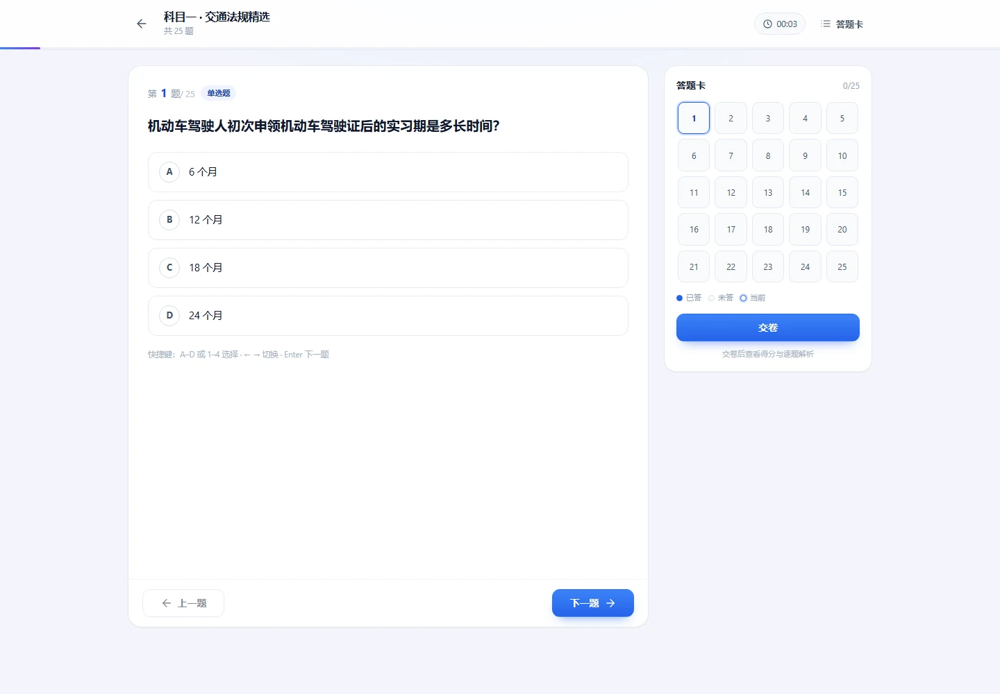
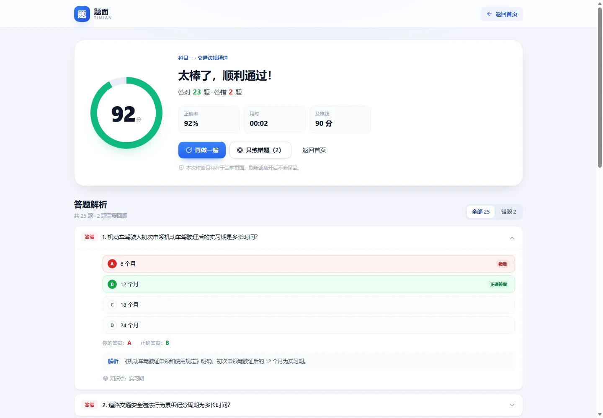
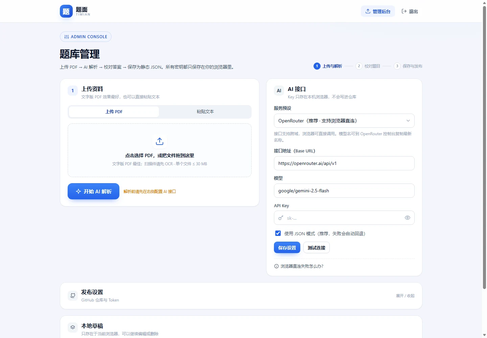
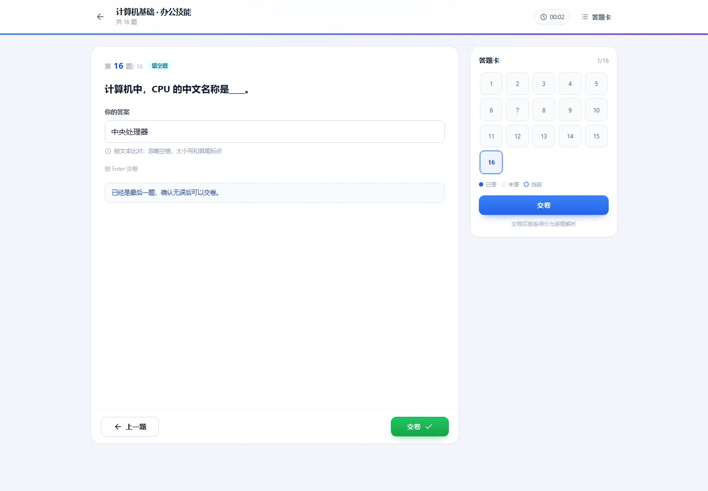

# 题面 · TiMian

把 PDF 变成可以随时开刷的题库。

纯静态站点，部署在 GitHub Pages：没有后端数据库，不收集账号，不存储任何答题记录。  
管理员登录后上传 PDF，由 AI 提取单选题、多选题、判断题、填空题、简答题并生成结构化 JSON；访客打开首页即可选择题库刷题。


## 目录

- [功能特性](#功能特性)
- [页面预览](#页面预览)
- [快速开始](#快速开始)
- [部署到 GitHub Pages](#部署到-github-pages)
- [管理员账号与安全边界](#管理员账号与安全边界)
- [配置 AI 解析](#配置-ai-解析)
- [发布题库](#发布题库)
- [题库 JSON 格式](#题库-json-格式)
- [项目结构](#项目结构)
- [常见问题](#常见问题)
- [设计取舍与限制](#设计取舍与限制)

## 功能特性

**访客（无需登录）**

- 首页题库卡片：标题、简介、分类、题目数量、单选 / 多选 / 判断 / 填空 / 简答统计
- 搜索与分类筛选
- 驾考风格答题页：圆形选项（单选 / 判断）、多选勾选、填空输入自动判分、简答题参考答案自测
- 答题卡：已答 / 未答 / 当前题 / 简答一目了然，可随时跳题
- 交卷反馈：客观题得分、答对 / 答错 / 未答、正确率、用时、及格线；简答题单独标注「不计分」
- 逐题解析：你的答案、正确答案、解析与知识点；简答题展示参考答案与你的草稿
- 只练错题（仅客观题）/ 再做一遍
- PC 键盘快捷键：`A–D` 或 `1–4` 选择 / 切换选项，`←` `→` 切题，`Enter` 下一题
- 手机端底部答题卡抽屉，适配安全区

**管理员（唯一账号）**

- 上传文字版 PDF，或直接粘贴题目文本
- 调用任意 OpenAI 兼容接口解析题目（Base URL / 模型 / Key 可配置）
- AI 输出约定好的结构化 JSON
- 解析结果可视化校对：改题干、改选项、勾选多选正确答案、填写填空标准答案、填写简答参考答案、删除题目、切换题型
- 自动标出「AI 待确认」的题目（原文没有答案或模型不确定）
- 保存为本地草稿、下载 JSON、一键发布到 GitHub Pages
- 自动生成 / 更新 `index.json`，让新题库出现在首页

**工程**

- 纯前端：Vite 8 + TypeScript 7 + 原生 DOM，无框架、无后端
- 题库以静态 JSON 存放在 `public/data/banks/`
- Hash 路由，GitHub Pages 子路径（`https://user.github.io/repo/`）直接可用
- 移动端 + PC 自适应，单文件 CSS，无外部字体 / CDN 依赖
- 不引入任何统计脚本，不记录答题数据

## 页面预览

| 答题页 | 交卷结果 |
| --- | --- |
|  |  |

| 管理后台 | 手机端 |
| --- | --- |
|  |  |

| 填空题 |
| --- |
|  |

> 填空题输入答案后按文本比对判分，计入总分；简答题只展示参考答案、不计分。

## 快速开始

先在**项目目录**里执行命令。Windows `cmd` 切换盘符必须加 `/d`，否则当前目录不会变，
npm 会在原来的目录找 `package.json`，报 `Could not read package.json`：

```bat
cd /d D:\codeProject\TiMian-ss
dir package.json
```

项目不绑定包管理器，**没有安装 pnpm 就直接用 npm**（两条命令效果完全一样）：

```bash
# 方式一：npm（Node 自带，无需额外安装）
npm install
npm run dev

# 方式二：pnpm
pnpm install
pnpm dev
```

打开 `http://localhost:5173`。

> Windows PowerShell 如果提示「无法加载文件 npm.ps1，因为在此系统上禁止运行脚本」，
> 请改用 `npm.cmd run dev`，或者在 cmd.exe 里执行。

### 想用 pnpm？

```bash
npm install -g pnpm@11.7.0
# 或者（使用 Node 自带的 corepack，可能要求管理员权限）
corepack enable pnpm
```

CI 使用 pnpm（`.github/workflows/deploy.yml`），本地用 npm 不影响部署。

默认管理员账号：

| 账号 | 密码 |
| --- | --- |
| `admin` | `TiMian@2026` |

> 这是公开的示例密码，**部署前一定要修改**：
>
> ```bash
> # npm
> npm run hash-password -- "你的新密码"
> npm run build
>
> # pnpm
> pnpm hash-password "你的新密码"
> pnpm build
> ```
>
> 脚本会重写 `src/admin.config.ts`，使用 PBKDF2-HMAC-SHA256（150,000 次迭代 +
> 随机盐）保存派生密钥，仓库里不会出现明文密码。

生产构建：

```bash
npm run build     # 类型检查 + 构建到 dist/
npm run preview   # 本地预览构建结果

# 或者 pnpm build / pnpm preview
```

## 部署到 GitHub Pages

### 方式 A：GitHub Actions（推荐）

1. 把仓库推送到 GitHub，默认分支为 `main`（如果是 `master`，请同步修改
   `.github/workflows/deploy.yml` 里的分支名）。
2. 打开仓库 **Settings → Pages → Build and deployment**，把 **Source** 设为
   **GitHub Actions**。
3. 推送代码后，`.github/workflows/deploy.yml` 会自动安装依赖、构建并部署。
4. 站点地址通常是 `https://<用户名>.github.io/<仓库名>/`。

`vite.config.ts` 使用 `base: './'`，所以项目子路径、自定义域名都不需要改配置。

### 方式 B：手动把 dist 推到 `gh-pages` 分支

```bash
npm run build
# 将 dist/ 的内容推到 gh-pages 分支根目录
```

如果采用这种方式，管理后台「发布设置」里的 **题库目录** 要从
`public/data/banks` 改成 `data/banks`，因为 `gh-pages` 分支上没有 `public/` 这一层。

## 管理员账号与安全边界

这是一个**没有后端**的静态站点。管理员登录校验在浏览器里完成，作用是限制
「上传 PDF / 调用 AI / 发布题库」这些入口，**不是真正的服务端鉴权**。

因此请理解以下边界：

- 密码哈希会随 JS 一起下载到浏览器。懂技术的人可以离线暴力破解一个弱密码。
  请使用足够长的密码，并通过脚本重新生成配置。
- 真正的安全边界是 **API Key** 和 **GitHub Token**：它们只保存在管理员本机的
  `localStorage` 里，不会进入代码仓库，也不会被提交到 GitHub。
- 不要把配置过 Token 的浏览器借给别人；不要在公共电脑上保存 Token。
- 建议使用 **fine-grained PAT**，只授权本站仓库，只给 **Contents: Read and write**，
  设置较短有效期，用完可以随时撤销。
- 登录态存在 `sessionStorage`，关闭标签页或 12 小时后失效。

如果你需要真正的多用户鉴权，请改用带后端 / Serverless 的方案；本项目刻意保持纯静态。

## 配置 AI 解析

登录后台，在「AI 接口」里填写：

| 字段 | 说明 |
| --- | --- |
| 服务预设 | OpenRouter / Gemini / 阿里云百炼 / SiliconFlow / DeepSeek / OpenAI / 自定义 |
| 接口地址 | OpenAI 兼容的 Base URL，程序会请求 `{Base URL}/chat/completions` |
| 模型 | 例如 `qwen-plus`、`google/gemini-2.5-flash`、`deepseek-chat`、`gpt-4o-mini` |
| API Key | 仅保存在本机浏览器 `localStorage` |
| JSON 模式 | 请求 `response_format: { type: "json_object" }`，失败会自动回退重试 |

填好后点 **测试连接**，成功后即可上传 PDF 解析。

### 关于浏览器跨域（CORS）

这是纯静态方案最常遇到的问题：**很多 AI 官方接口不允许网页直接调用**。

| 服务 | 浏览器直连 | 建议 |
| --- | --- | --- |
| OpenRouter | ✅ 支持 | 推荐，无需代理 |
| Google Gemini（OpenAI 兼容） | ✅ 支持 | 有免费额度 |
| 阿里云百炼 DashScope | ✅ 支持（`dashscope.aliyuncs.com` 实测） | 可直接用；专属域名异常时改回该地址或走代理 |
| SiliconFlow | ⚠️ 视服务策略 | 失败时改用代理 |
| DeepSeek 官方 | ❌ 通常被拦截 | 需要代理 |
| OpenAI 官方 | ❌ 被拦截 | 需要代理 |

如果「测试连接」提示无法连接或跨域失败，有两个选择：

1. 换一个支持 CORS 的服务（OpenRouter / Gemini / 百炼）；
2. 部署 `deploy/cloudflare-worker.js` 里的 Cloudflare Worker 代理：
   - 免费额度足够个人使用；
   - 可以把 API Key 放在 Worker 环境变量里，浏览器端只填 `proxy`；
   - 部署步骤和配置项都写在文件顶部注释里；
   - 在「AI 接口」里把 Base URL 填成 `https://<worker>.workers.dev/v1`（按你代理的路径调整）。

### 使用阿里云百炼（DashScope）

百炼的千问模型提供 OpenAI 兼容接口，实测 `dashscope.aliyuncs.com` 允许浏览器跨域，
可以直接在这个静态站里使用。

**1. 创建 API Key**

打开[百炼控制台 → API Key](https://bailian.console.aliyun.com/cn-beijing/model/settings/api-key)，
先确认右上角地域，再创建 / 复制 API Key（`sk-...`）。API Key 与地域绑定，不能跨地域混用。

**2. 在「AI 接口」中填写**

| 字段 | 值 |
| --- | --- |
| 服务预设 | 阿里云百炼 DashScope（Qwen） |
| 接口地址 | `https://dashscope.aliyuncs.com/compatible-mode/v1` |
| 模型 | `qwen-plus`（推荐）/ `qwen-max` / `qwen-turbo` / `qwen-long` |
| API Key | 你的 `sk-...` |
| JSON 模式 | 勾选（不兼容时会自动回退） |

点「测试连接」，成功后即可上传 PDF。

**地域与 Base URL**

| 地域 | Base URL |
| --- | --- |
| 华北2（北京） | `https://dashscope.aliyuncs.com/compatible-mode/v1` |
| 北京（业务空间专属） | `https://{WorkspaceId}.cn-beijing.maas.aliyuncs.com/compatible-mode/v1` |
| 新加坡 | `https://dashscope-intl.aliyuncs.com/compatible-mode/v1` |
| 新加坡（业务空间专属） | `https://{WorkspaceId}.ap-southeast-1.maas.aliyuncs.com/compatible-mode/v1` |

`{WorkspaceId}` 在百炼控制台的「业务空间详情」里查看。专属域名性能更好；如果浏览器直连时报
CORS，换回 `dashscope.aliyuncs.com` / `dashscope-intl.aliyuncs.com`，或使用 Worker 代理。

**模型怎么选**

- `qwen-plus`：性价比最好，推荐日常题库解析
- `qwen-max`：准确率更高，适合排版复杂 / 答案容易错的题目
- `qwen-turbo`：更便宜、更快，适合简单题库
- `qwen-long`：超长上下文，适合一次喂很长的文本（本站会分段，通常用不到）
- 具体可用模型以控制台「模型列表」为准；新模型直接填模型名即可

**安全提醒（重要）**

阿里云官方明确建议不要在前端代码 / 浏览器里使用长期有效的 API Key。这个项目是纯静态站，
Key 会存在管理员浏览器的 `localStorage` 中，因此建议：

1. **首选**：部署 [Cloudflare Worker 代理](#关于浏览器跨域cors)，把 Key 放在 Worker 环境变量里，
   网页里只填 `proxy`；
2. 或使用**专用 Key**，在百炼控制台把权限限制为只允许需要的 Qwen 模型，必要时配置 IP 白名单；
3. 不要用主账号的通用 Key，定期轮换，发现异常立即删除；
4. 临时 Key（最长 1800 秒）更安全，但每次都要重新生成，适合一次性导入。

> 用 Worker 代理百炼时：`UPSTREAM_ORIGIN` 填 `https://dashscope.aliyuncs.com`，
> 网页里的 Base URL 填 `https://<worker>.workers.dev/compatible-mode/v1`。

### AI 输出约定

系统提示词要求模型只输出如下 JSON（`answer` 规则见后文）：

```json
{
  "questions": [
    {
      "type": "single",
      "stem": "机动车驾驶人初次申领机动车驾驶证后的实习期是多长时间？",
      "options": ["6 个月", "12 个月", "18 个月", "24 个月"],
      "answer": "B",
      "analysis": "初次申领后的 12 个月为实习期。",
      "knowledge": "实习期",
      "confidence": "high"
    },
    {
      "type": "multiple",
      "stem": "下列哪些属于操作系统？",
      "options": ["Windows", "Linux", "macOS", "Photoshop"],
      "answer": ["A", "B", "C"],
      "analysis": "Windows、Linux、macOS 都是操作系统。",
      "knowledge": "操作系统",
      "confidence": "high"
    },
    {
      "type": "judge",
      "stem": "雾天行车应当开启雾灯和危险报警闪光灯。",
      "options": ["正确", "错误"],
      "answer": "正确",
      "analysis": "雾天能见度低，应开启雾灯和双闪。",
      "confidence": "high"
    },
    {
      "type": "fill",
      "stem": "计算机中，CPU 的中文名称是____。",
      "answer": "中央处理器",
      "analysis": "CPU（Central Processing Unit）即中央处理器。",
      "knowledge": "硬件基础",
      "confidence": "high"
    },
    {
      "type": "short",
      "stem": "请简述 CPU 的主要功能。",
      "answer": "CPU 负责运算和控制，由运算器、控制器等组成，协调计算机各部件工作。",
      "analysis": "评分要点：运算、控制、协调各部件。",
      "confidence": "high"
    }
  ]
}
```

程序会做这些归一化处理：

- 去掉题号、`【单选题】` 等前缀；去掉选项的 `A.` / `B、` 前缀
- 选择题答案支持 `"B"`、`"b"`、`"B."`、`"答案：B"`、选项原文等写法
- 多选题答案支持 `["A","C"]`、`"A,C"`、`"AC"`、`"A、C"` 等写法，统一存成 `"A,C"`
- 判断题答案归一化为 `A`（正确）/ `B`（错误），选项固定为「正确 / 错误」
- 填空题的 `answer` 是标准答案文本，会去掉「答案：」前缀，参与自动判分
- 简答题的 `answer` 是参考答案原文，可以留空；不参与自动判分
- 材料分析题、论述题、计算题会被跳过，并在解析结果里显示跳过的数量
- 按题干去重（分块重叠造成的重复题会合并）
- `confidence: low` 或原文没有答案的题目，在校对页标为「AI 待确认」

### 判分规则

- **单选 / 判断**：答案完全一致得分
- **多选**：必须与正确答案完全一致才得分；少选、错选、多选都算错
- **填空**：用户输入与标准答案比对，忽略空格、大小写和首尾标点；一致即得分
- **简答**：不参与自动判分；答题页可以写草稿、查看参考答案，成绩页单独标注「不计分」
- **总分** = 客观题（单选 + 多选 + 判断 + 填空）答对数 ÷ 客观题总数 × 100；简答题不计入分母
- 不及格线默认为 90 分，可在 `src/config.ts` 的 `PASS_SCORE` 调整

> **AI 给出的答案不保证正确。** 请在校对页逐题检查，尤其是「AI 待确认」的题目。
> 发布前程序会阻止保存「没有设置答案」「选项为空」的题目。

## 发布题库

### 自动发布（推荐）

1. 在 GitHub 创建 fine-grained Token：
   - Repository access：只选本站仓库；
   - Permissions → Contents：**Read and write**。
2. 后台展开「发布设置」，填写 owner / repo / 分支 / 题库目录 / Token，点 **保存**。
3. 点 **测试连接**，确认显示「有写入权限」。
4. 在题库信息区点 **发布到 GitHub Pages**。

发布时会发生两件事：

- 把 `public/data/banks/<bank-id>.json` 写入仓库；
- 更新 `public/data/banks/index.json`，保留已有题库。

随后 GitHub Actions 会重新构建站点，通常 **1–2 分钟** 后新题库出现在首页。
发布完成的题库会先以「本地 / 待生效」状态显示在管理员浏览器里，Pages 构建完成后自动切换为远程版本。

> Token 会明文保存在当前浏览器的 `localStorage` 中。请使用最小权限、定期轮换，
> 不要在公共设备上保存。

### 手动发布

没有 Token 或不想配置 Token 时：

1. 后台点 **下载题库 JSON** 和 **下载 index.json**；
2. 把题库文件放到 `public/data/banks/`；
3. 用下载的 `index.json` 覆盖同名文件（或手动在 `banks` 数组里加一条）；
4. 提交并推送。

### 本地草稿

「保存为本地草稿」只写入当前浏览器的 `localStorage`，用于临时保存解析结果；
它不会出现在其他设备或访客的首页上。草稿可以继续编辑、下载或删除。

## 题库 JSON 格式

### `public/data/banks/index.json`

首页只加载这个索引文件，题库详情按需加载，保持首屏轻量。

```json
{
  "version": 1,
  "updatedAt": "2026-02-10T09:00:00.000Z",
  "banks": [
    {
      "id": "traffic-rules",
      "title": "科目一 · 交通法规精选",
      "description": "覆盖实习期、记分、酒驾、高速公路与灯光使用等高频考点。",
      "category": "科目一",
      "emoji": "🚦",
      "color": "blue",
      "source": "示例数据",
      "file": "traffic-rules.json",
      "questionCount": 25,
      "singleCount": 18,
      "multipleCount": 0,
      "judgeCount": 7,
      "fillCount": 0,
      "shortCount": 0,
      "createdAt": "2026-02-10T09:00:00.000Z",
      "updatedAt": "2026-02-10T09:00:00.000Z"
    }
  ]
}
```

`color` 可选：`blue` / `violet` / `emerald` / `amber` / `rose` / `cyan` / `indigo` / `slate`。

### `public/data/banks/<file>.json`

```json
{
  "id": "traffic-rules",
  "title": "科目一 · 交通法规精选",
  "description": "覆盖实习期、记分、酒驾等高频考点。",
  "category": "科目一",
  "emoji": "🚦",
  "color": "blue",
  "source": "示例数据",
  "createdAt": "2026-02-10T09:00:00.000Z",
  "updatedAt": "2026-02-10T09:00:00.000Z",
  "questions": [
    {
      "id": "q1",
      "type": "single",
      "stem": "题干文本",
      "options": [
        { "key": "A", "text": "选项 A" },
        { "key": "B", "text": "选项 B" },
        { "key": "C", "text": "选项 C" },
        { "key": "D", "text": "选项 D" }
      ],
      "answer": "B",
      "analysis": "解析（可选）",
      "knowledge": "知识点（可选）",
      "confidence": "high"
    },
    {
      "id": "q2",
      "type": "multiple",
      "stem": "多选题题干",
      "options": [
        { "key": "A", "text": "选项 A" },
        { "key": "B", "text": "选项 B" },
        { "key": "C", "text": "选项 C" },
        { "key": "D", "text": "选项 D" }
      ],
      "answer": "A,C",
      "analysis": "解析（可选）"
    },
    {
      "id": "q3",
      "type": "judge",
      "stem": "判断题题干",
      "options": [
        { "key": "A", "text": "正确" },
        { "key": "B", "text": "错误" }
      ],
      "answer": "A",
      "analysis": "解析（可选）"
    },
    {
      "id": "q4",
      "type": "fill",
      "stem": "填空题题干，空格用 ____ 表示",
      "options": [],
      "answer": "标准答案",
      "analysis": "解析（可选）",
      "knowledge": "知识点（可选）"
    },
    {
      "id": "q5",
      "type": "short",
      "stem": "简答题题干",
      "options": [],
      "answer": "参考答案原文（可为空）",
      "analysis": "评分要点（可选）"
    }
  ]
}
```

约定：

- `type` 支持 `single`（单选）、`multiple`（多选）、`judge`（判断）、`fill`（填空）、`short`（简答）
- 单选 / 判断：`answer` 为单个选项 key；判断题用 `A` 表示正确、`B` 表示错误
- 多选：`answer` 为逗号分隔的 key（如 `"A,C"`），**全部选对才得分**
- 填空：`options` 为空数组，`answer` 为标准答案文本，**参与自动判分**；比对时忽略空格、大小写和首尾标点
- 简答：`options` 为空数组，`answer` 为参考答案文本（可为空），不参与判分
- 加载时会过滤「选择题没有合法答案」「选择题选项少于 2 个」「填空题没有标准答案」的题目；简答题只要求有题干
- 选择题支持 2–6 个选项，选项 key 会按顺序重新编号为 A–F
- 旧版 `index.json` 没有 `multipleCount` / `fillCount` / `shortCount` 时按 0 处理
- 不存储任何用户作答数据，答题过程只在内存中

## 项目结构

```text
.
├─ .github/workflows/deploy.yml   # GitHub Pages 自动构建部署
├─ deploy/cloudflare-worker.js    # 可选的 AI 接口 CORS 代理
├─ public/
│  ├─ .nojekyll
│  ├─ favicon.svg
│  └─ data/banks/                 # 静态题库：index.json + 每套题库一个 JSON
├─ scripts/set-admin-password.mjs # 重新生成管理员密码哈希
├─ src/
│  ├─ pages/                      # 首页 / 登录 / 答题 / 管理后台
│  ├─ services/                   # AI、PDF、题库仓库、GitHub 发布、登录
│  ├─ ui/layout.ts                # 页头 / 页脚 / 品牌
│  ├─ utils/                      # DOM、格式化、加密、存储、路由工具
│  ├─ admin.config.ts             # 管理员账号哈希（由脚本生成）
│  ├─ config.ts                   # 应用配置、AI 预设、配色
│  ├─ router.ts                   # hash 路由
│  ├─ types.ts                    # 数据模型
│  ├─ styles.css                  # 全站样式（含响应式）
│  └─ main.ts
├─ index.html
├─ vite.config.ts
└─ package.json
```

## 常见问题

**Q：上传 PDF 后提示没有提取到文字？**  
A：大概率是扫描件（图片型 PDF）。请先用 OCR 工具转成文字版 PDF，或在后台改用
「粘贴文本」模式。文字版 PDF 的识别效果最好。

**Q：AI 解析很慢 / 报 429？**  
A：题目较多时会按约 4200 字符分段顺序请求，需要一点时间。429 表示限流或额度不足，
请稍后重试或更换 Key。免费模型可能不稳定。

**Q：解析结果少了题目？**  
A：材料分析题、论述题、计算题会被主动跳过；单选、多选、判断、填空、简答都已支持。
如果某段 JSON 被截断，程序会自动把该段拆成两半重试；仍失败时可以换一个输出更稳定的模型。

**Q：多选题怎么判分？**  
A：必须与正确答案完全一致才得分，少选、错选、多选都算错。例如正确答案是 A、C，
只选 A 不得分；只练错题时也会把这道多选重新拿出来。

**Q：填空题怎么判分？**  
A：用户输入与标准答案比对，忽略空格、大小写和首尾标点，一致即得分，并计入总分。
填空题不做同义词匹配，所以标准答案要尽量写成最常见的形式；标点、空格差异不会影响判分。

**Q：简答题为什么不计分？**  
A：纯静态站没有可靠的主观题自动判卷能力，所以简答题只展示参考答案，不参与总分。
答题时可以写草稿并查看参考答案自测；总分只按单选、多选、判断、填空计算，成绩页会单独标注「简答 N 题不计分」。

**Q：提示 CORS / 无法连接 AI？**  
A：参考[关于浏览器跨域](#关于浏览器跨域cors)。OpenRouter、Gemini、阿里云百炼支持浏览器直连；
DeepSeek、OpenAI 官方接口需要 Worker 代理。

**Q：发布报 401 / 403 / 404？**  
A：检查 Token 是否有效、是否只授权了目标仓库、Contents 是否为 Read and write；
检查 owner / repo / 分支是否填写正确。404 通常是 Token 没有该仓库权限。

**Q：发布成功了，但首页没有新题库？**  
A：GitHub Pages 需要 1–2 分钟重新构建；构建完成后刷新页面（必要时强制刷新）。
也可以在仓库的 Actions 页面查看部署进度。

**Q：登录一直失败？**  
A：确认使用的是 `src/admin.config.ts` 里配置的账号密码。修改密码后需要重新构建部署。
如果浏览器之前登录过，会话最多保留 12 小时；可以清除站点数据后重试。

**Q：为什么访客看不到我在后台看到的题库？**  
A：那是「本地草稿」，只存在你的浏览器里。点「发布到 GitHub Pages」后，访客才能看到。

**Q：会保存做题记录吗？**  
A：不会。答题状态只在当前页面内存中，刷新即丢失。`localStorage` 只存三类东西：
本地题库草稿、AI 接口配置、GitHub 发布配置；`sessionStorage` 只存管理员登录态。

## 设计取舍与限制

- **纯静态优先**：没有数据库、没有服务端，因此无法做真正的账号体系、无法跨设备同步草稿、
  也无法在服务端保存答题记录。这是刻意的取舍。
- **AI 解析是辅助**：模型可能漏题、改错题意或给出错误答案，必须由管理员校对后发布。
- **主观题不计分**：简答题只能展示参考答案，无法可靠自动评分；客观题总分不受影响。
- **填空按文本判分**：只看标准答案文本是否一致，不做同义词 / 语义判断；标准答案由管理员校对。
- **多选全对才得分**：与常见考试规则一致，不做部分给分，避免分数虚高。
- **浏览器内调用 AI**：API Key 暴露在管理员本机浏览器中，这也是使用自己的 Key 的代价。
  如需多人共用，建议改为 Serverless 代理并在服务端鉴权。
- **单管理员**：只支持一个固定账号。需要多用户时请扩展后端。
- **规模**：单次 PDF 最多解析 300 页 / 40 万字符，文件不超过 30 MB；
  单套题库建议控制在几百题以内，静态 JSON 加载会更快。
- **兼容性**：面向现代浏览器（Chrome / Edge / Safari / Firefox 近两年版本）。
  PDF 解析使用 pdf.js 的 ES Module Worker，需要 HTTPS 或 localhost。

## License

本项目的示例题库仅用于演示。请自行确认上传 PDF 的版权与使用授权。
